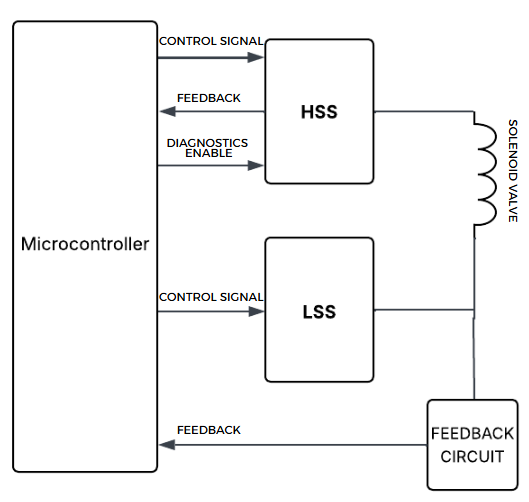
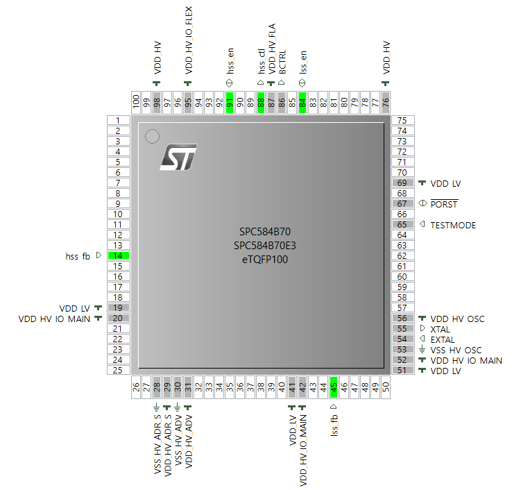
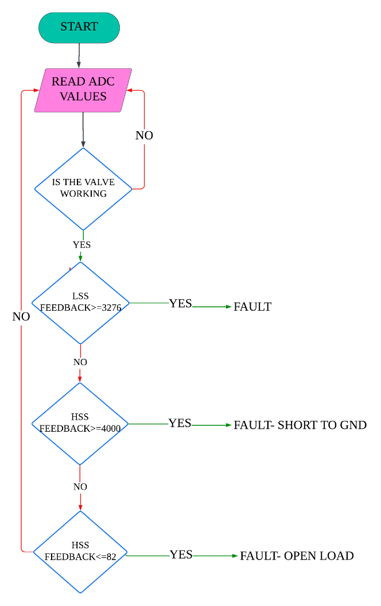
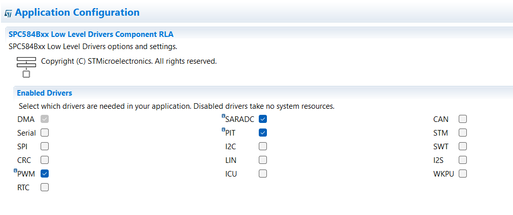

# SPC584Bx Analog & Digital Input Acquisition with HSS/LSS Valve Control

Embedded C project built during a one-month internship at **ZF Commercial Vehicle Control Systems India Ltd** (Ambattur, Chennai), 20 May - 20 June 2025.
The firmware runs on an **STMicroelectronics SPC584B70E3** automotive microcontroller, configured in **SPC5Studio**. It acquires analog and digital inputs, drives a **High-Side Switch (HSS)** and **Low-Side Switch (LSS)** that actuate a solenoid valve, and monitors their current-sense feedback to detect faults and protect the load.



## Highlights

- 12-bit **SAR ADC** acquisition (pressure sensor, on-chip temperature sensor, HSS/LSS current-sense lines) with ADC-to-voltage conversion
- Digital input acquisition with **GPIO polling** and the **ICU (Input Capture Unit)** driver
- **1 kHz PWM** control of the HSS and ON/OFF control of the LSS
- **Fault detection** on ADC thresholds: short circuit and open load
- **Safety protocol**: PWM cut-off, error counting, timed retry with a **PIT timer**, and permanent shutdown after 10 errors
- Full tool-chain flow: pin mapping, driver configuration, code generation, build to `.hex`, flashing with P&E Multilink / SPC5 Flasher

## Tech stack

| Area | Details |
|---|---|
| MCU | STMicroelectronics SPC584B70E3 (eTQFP100) |
| IDE | SPC5Studio with RLA low-level drivers (SARADC, PWM, PIT, ICU, PAL) |
| Language | Embedded C |
| Power switches | Infineon BTF6070-2ERV (HSS), Infineon BTT3018EJ (LSS) |
| Programmer | P&E Multilink / SPC5 Flasher |

## Repository structure

```
.
├── src
│   ├── phase1_inputs
│   │   ├── pressure_sensor_adc.c       # SAR ADC, pressure sensor, voltage conversion
│   │   ├── temperature_sensor_adc.c    # SAR ADC, temperature sensor
│   │   ├── digital_input_gpio.c        # switch input via GPIO polling
│   │   └── digital_input_icu.c         # switch input via ICU driver
│   └── phase2_valve_control
│       └── main.c                      # HSS/LSS control, feedback monitoring, fault handling
├── docs/images                         # block diagram, pin map, flowchart, IDE screenshots
├── LICENSE
└── README.md
```

Each file in `src/` is the `main.c` of its own SPC5Studio application. Create a project for the SPC584B70E3, add the components listed below, generate code, and replace the generated `main.c`.

## Phase 1: reading inputs

| Example | Peripheral | What it does |
|---|---|---|
| `pressure_sensor_adc.c` | SAR ADC, channel 67 | Continuous conversion, ASCII digits for display, voltage = ADC / 4095 x 5 V |
| `temperature_sensor_adc.c` | SAR ADC, channel 38 | Continuous conversion of the temperature sensor |
| `digital_input_gpio.c` | GPIO (PORT_B, pin 2) | Polls an external switch with `pal_lld_readpad()` |
| `digital_input_icu.c` | ICU on eMIOS | Enables ICU capture and polls the input level through `SIUL2.GPDI` |

## Phase 2: HSS/LSS control with feedback monitoring

### Requirements

- HSS control at **1 kHz**, supporting PWM and ON/OFF modes
- LSS control at **2 kHz**, ON/OFF mode active only while the HSS is in PWM mode
- Analog current-sense feedback from both switches sampled through the ADC
- Detection of short circuit and open load, with timing-accurate control signals

### Pin assignment



| Function | Pin | ADC channel | Mode |
|---|---|---|---|
| HSS control signal | 88 | n/a | Output (PWM / GPIO) |
| HSS feedback (current sense) | 14 | 12 | Analog input (ADC) |
| HSS diagnostics enable | 91 | n/a | Output (GPIO) |
| LSS control signal | 84 | n/a | Output (GPIO) |
| LSS feedback (current sense) | 45 | 82 | Analog input (ADC) |

### ADC to voltage

```
Vin = ADC value / 4095 x Vref        (12-bit ADC, Vref = 5 V)
```

### Fault detection



| Switch | Condition (ADC counts) | Approx. voltage | Fault |
|---|---|---|---|
| LSS | >= 3276 | >= 4.0 V | General fault |
| HSS | >= 4000 | >= 4.9 V | Short circuit |
| HSS | <= 82 | <= 0.1 V | Open load |

On a fault the firmware:

1. Stops the HSS PWM immediately and clears the "no error" flag
2. Increments the error counter and starts a PIT timer (2 s)
3. Re-enables the PWM when the timer fires, so a transient fault can recover
4. After 10 errors, disables HSS and LSS and enters shutdown until manual reset

## Build and flash

1. In SPC5Studio: **File > New > SPC5 Project**, select **SPC584B70E3EHC0x (100-pin)**.
2. Add the Platform, Init Package and Low Level Drivers components, then enable the SARADC, PWM, PIT and PAL drivers (ICU for the digital input example).

   

3. Assign pins in the PinMap editor as in the table above, set the ADC to 12-bit software-triggered conversions on channels 12 and 82.
4. **Generate Application Code**, replace the generated `main.c` with the file you want to run, then **Compile**.
5. Flash the generated `.hex` from the `Debug` folder with a P&E Multilink or SPC5 Flasher.

## What I learned

- Configuring SAR ADC, GPIO, ICU, PWM and PIT peripherals on an automotive MCU
- Reading datasheets (MCU, smart power switches) and designing RC filters, `fc = 1 / (2 pi R C)`
- Designing diagnostic and fault-handling logic for safety-critical loads
- The full embedded workflow: configure, generate, build, flash, test on hardware

## References

- [SPC584Bx datasheet](https://www.st.com/resource/en/datasheet/spc584b70e3.pdf)
- [Infineon BTF6070-2ERV (HSS) datasheet](https://www.infineon.com/dgdl/Infineon-BTF6070-2ERV-DataSheet-v01_00-EN.pdf?fileId=5546d4626cb27db2016d5e7e6e8c0667)
- [Infineon BTT3018EJ (LSS) datasheet](https://www.infineon.com/dgdl/Infineon-BTT3018EJ-DataSheet-v01_00-EN.pdf?fileId=5546d4626fc1ce0b016ff157937b4290)
- [Programmer's reference manual for Book E processors](https://www.st.com/resource/en/reference_manual/rm0004-programmers-reference-manual-for-book-e-processors-stmicroelectronics.pdf)
- [SPC58xx temperature sensor technical note (TN1339)](https://www.st.com/resource/en/technical_note/tn1339-spc58xx-temperature-sensor-stmicroelectronics.pdf)

## Author

**Harsanya K R**, B.Tech Electronics and Communication Engineering, Vellore Institute of Technology, Chennai.

This is an educational internship project. It is not an official ZF product and contains no proprietary ZF material.
